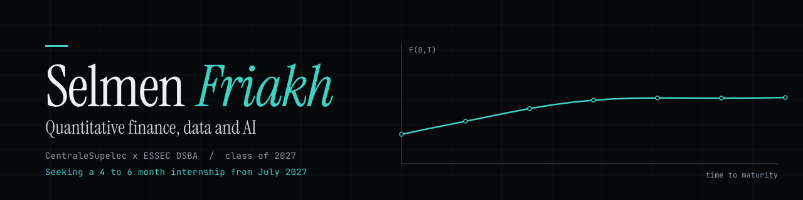

  

<a href="https://selmen95.github.io"><b>Open my web page: selmen95.github.io</b></a>

I am a student in the CentraleSupelec x ESSEC Data Sciences & Business Analytics double degree (graduating June 2027). I build models and data products, and I like problems where the maths has to survive contact with messy data: commodity curves, pricing, purchasing, analytics.

**Looking for:** a 4 to 6 month internship starting July 2027 in quantitative finance, data science, AI or commodities.

**Contact:** [selmen.friakh@gmail.com](mailto:selmen.friakh@gmail.com)

## Selected projects

### [commodity-curve-schwartz-smith](https://github.com/Selmen95/commodity-curve-schwartz-smith)
Two-factor Schwartz-Smith model fitted to WTI futures curves with a Kalman filter, with a calibration output and a test suite.
`Python` `NumPy` `Kalman filter` `pytest`

### [deskprep](https://github.com/Selmen95/deskprep)
A preparation platform I built for myself: courses, quizzes and progress tracking for recruiting tests and quant or tech interviews.
`TypeScript` `Next.js`

### [fluxi](https://github.com/Selmen95/fluxi)
Showcase version of a purchasing platform where AI agents query and act on the database. It is derived from real client projects delivered through Opsen under signed quotes; it is anonymised, runs on synthetic data and names no client.
`TypeScript` `Next.js` `PostgreSQL` `Prisma` `Claude Sonnet` `Claude Haiku`

### [bazarpilot](https://github.com/Selmen95/bazarpilot)
Showcase version of a promotion analytics pipeline, derived from real client work delivered through Opsen under signed quotes; anonymised, on synthetic data, no client named.
`Python` `SQL` `pandas`

### [argos](https://github.com/Selmen95/argos)
Case-intake prototype built with a classmate for the AI x Justice hackathon organised by Microsoft France (October 2026, 2nd place): a citizen describes a dispute, is guided through a structured file, and hands it to a lawyer. This repository is the state of 15 October, with 155 tests.
`TypeScript` `Next.js` `SQLite`

## Stack

| Area | Tools |
| --- | --- |
| Quant and modelling | Python, NumPy, pandas, SciPy, state-space models, Kalman filtering |
| Data | SQL, PostgreSQL, SQLite, data pipelines, Excel |
| Web and AI | TypeScript, Next.js, React, Prisma, LLM APIs and tool use |
| Practice | Git, pytest, vitest, typed schemas |

## Elsewhere

Web page: [selmen95.github.io](https://selmen95.github.io)

Email is the best way to reach me: [selmen.friakh@gmail.com](mailto:selmen.friakh@gmail.com)
